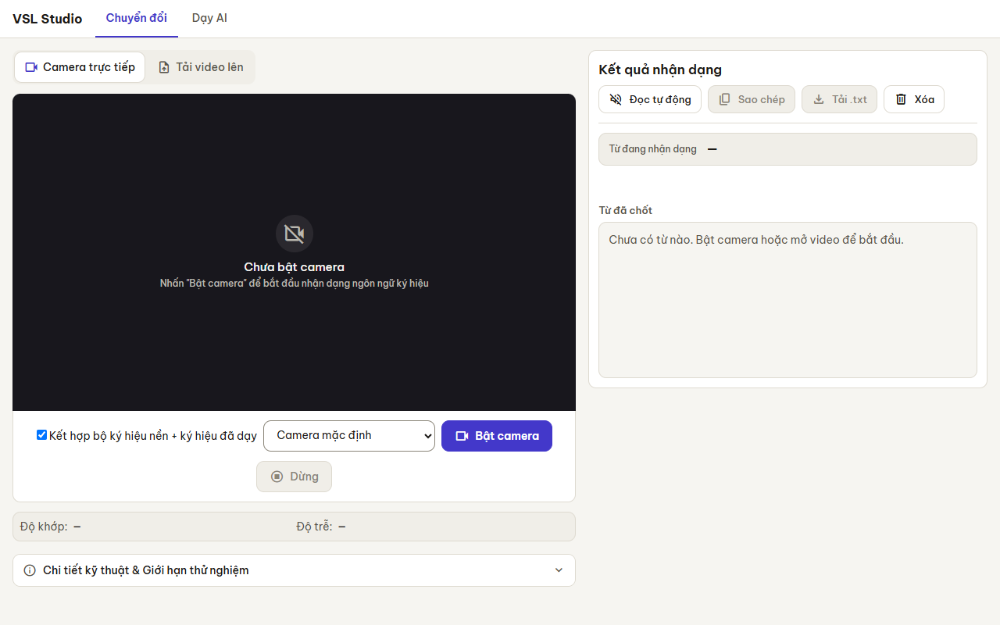

# VSL Studio

Nhận dạng ngôn ngữ ký hiệu Việt Nam (VSL) từ camera: người ký làm ký hiệu trước camera, máy viết ra từ tiếng Việt tương ứng.

**Dùng thử:** <https://vsl1.lvn123.site>. Đây là bản thử nghiệm chạy trên một máy tính cá nhân, nên có lúc không truy cập được.

Kho này công khai phần giới thiệu và tài liệu của dự án. Mã nguồn, dữ liệu và trọng số mô hình được giữ riêng.



## Hệ thống làm được gì

Trạng thái ngày 23/11/2026:

- Nhận 400 từ đơn của một mô hình nền đã huấn luyện sẵn.
- Người dùng tự dạy thêm ký hiệu của mình bằng vài clip ngắn. Một lượt học mất khoảng 15 giây (đo với 24 clip) và ký hiệu mới dùng được ngay, không cần khởi động lại.
- Ký liền nhiều ký hiệu đã dạy mà không phải hạ tay giữa các ký hiệu.
- Chạy trong trình duyệt. Ứng dụng Android dùng chung lõi nhận dạng viết bằng Rust với máy tính.

Hệ thống nhận từng từ. Nó chưa dịch câu VSL tự nhiên.

## Cách hoạt động

```text
Camera (trình duyệt hoặc điện thoại)
  -> bộ theo dõi: 76 điểm khung xương ở mỗi khung hình
  -> chuẩn hoá toạ độ
  -> mô hình nền (400 từ đơn) + đầu phân loại của ký hiệu đã dạy
  -> bộ giải mã theo lượt ký: chọn các từ của cả lượt
  -> chữ tiếng Việt trên trang web hoặc ứng dụng
```

- **Chỉ dùng điểm khung xương.** Sau bước theo dõi tay, phần nhận dạng không dùng hình ảnh.
- **Dạy thêm không đụng tới mô hình nền.** Mỗi máy học một lớp nhỏ trên đặc trưng của mô hình nền. Một ký hiệu đã dạy chỉ được chấp nhận khi lớp này và phép so chuyển động (DTW) cùng đồng ý.
- **Không đoán.** Kết quả không đủ chắc thì không được viết ra.

Chi tiết nằm trong [báo cáo quá trình và cách làm](docs/BAO_CAO_QUA_TRINH_2026-11-23.md) ([bản PDF](docs/BAO_CAO_QUA_TRINH_2026-11-23.pdf)).

## Kết quả đo ngày 22–23/11/2026

| Hạng mục | Trước | Sau | Điều kiện đo |
|---|---|---|---|
| Ký liền 3–5 ký hiệu đã dạy, không nghỉ tay | 120/159 ký hiệu | 145/159 | 40 chuỗi ghép từ clip đã dạy, phát lại |
| Thời gian tính một cửa sổ trong lõi | 53 ms | 15 ms | Kết quả giống từng bit trên 1.454 cửa sổ |
| Một lượt học sau khi thêm một clip | 70–100 giây | 13–16 giây | 24 clip, máy phát triển |
| Khung hình mỗi giây qua địa chỉ công khai | 3,8 (WebSocket) | 24,5 (WebRTC) | Cùng đoạn 5 ký hiệu |
| Từ sai trong 14,4 phút ký ngoài từ vựng | 75 | 0 | Phát lại điểm khung xương |

Mọi con số trên đo bằng clip phát lại, chưa phải người thật trước camera thật.

## Giới hạn

- Chưa có phép đo trên một nhóm người ký tách riêng. Hệ thống chưa đủ điều kiện để dùng thật.
- Ký hiệu đã dạy hiện chỉ đáng tin với chính người đã dạy nó: ở người ký khác, 2/16 lần được nhận (đo ngày 15/11/2026).
- Với ký hiệu của người ký khác, bộ 400 từ nền viết đúng 53 từ và sai 12 từ trên 131 clip từ điển.
- Ngữ pháp và nét mặt của VSL chưa có trong mô hình.

## Quá trình

Dự án bắt đầu tháng 9/2026. Trong tháng 10, mô hình tự huấn luyện trên video tự thu chỉ đạt 44,8% từ đúng trên bản ghi chưa học, so với mục tiêu đặt trước là 80%. Từ 31/10, dự án chuyển sang dùng một mô hình nền có sẵn và học thêm một lớp nhỏ cho từng người dùng. Các thử nghiệm thất bại cũng được ghi lại; xem mục 3 và mục 7 của báo cáo.

## Ghi nhận

- Kiến trúc mô hình nền: SPOTER, *Sign Pose-based Transformer for Word-level Sign Language Recognition* (Boháček và Hrúz, 2022).
- Trọng số 400 từ VSL: kho [IvanScopy/VSL400](https://github.com/IvanScopy/VSL400).
- Bộ theo dõi tay và thân: RTMW (qua `rtmlib`) và MediaPipe.
- Đường truyền công khai: Cloudflare Tunnel và máy chủ chuyển tiếp TURN của Cloudflare.
- Mã, phép đo và tài liệu được viết cùng trợ lý lập trình AI Claude, theo yêu cầu và quyết định của chủ dự án.

Các tệp nguồn mà báo cáo dẫn tới (`docs/FOUNDATION.md`, `docs/AUTO_TEACH.md`...) nằm trong kho riêng.
